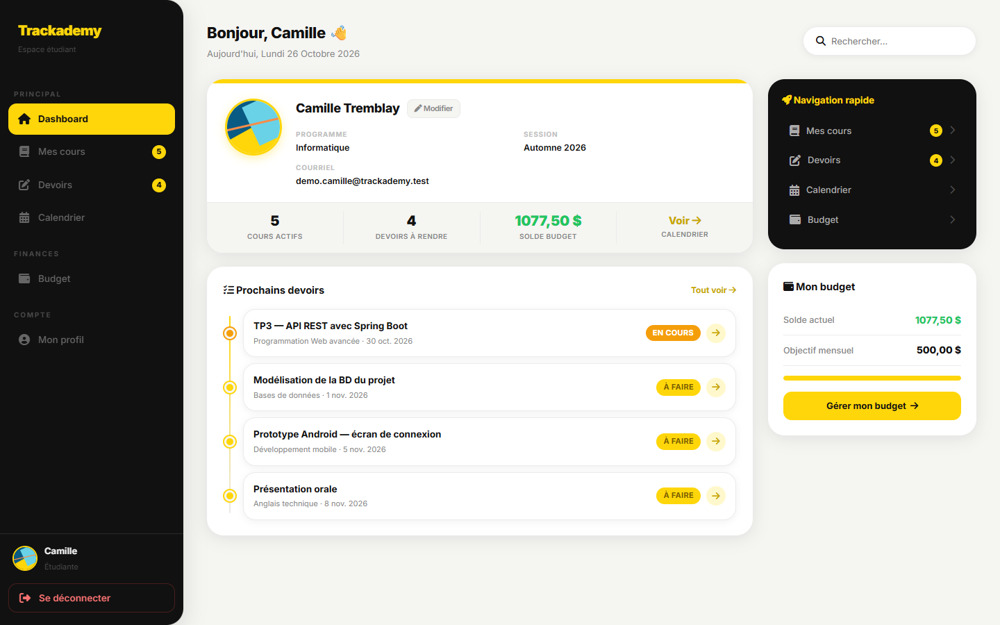
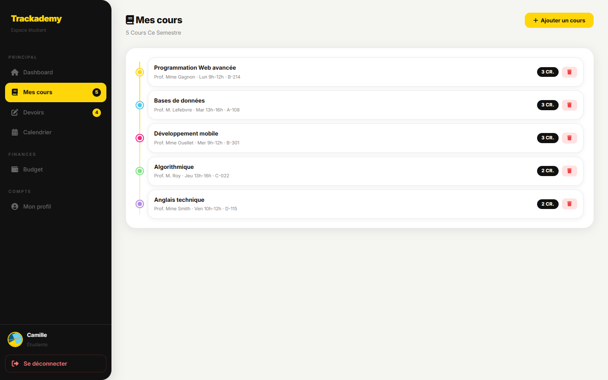
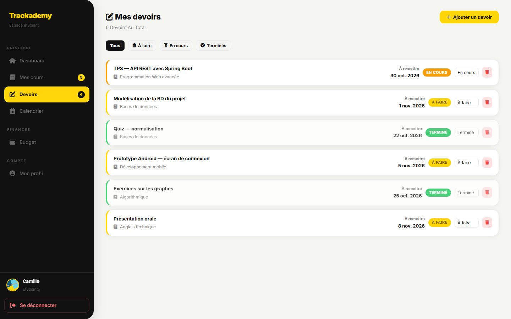
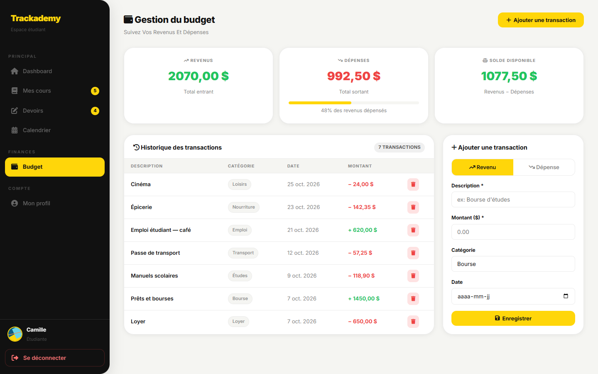
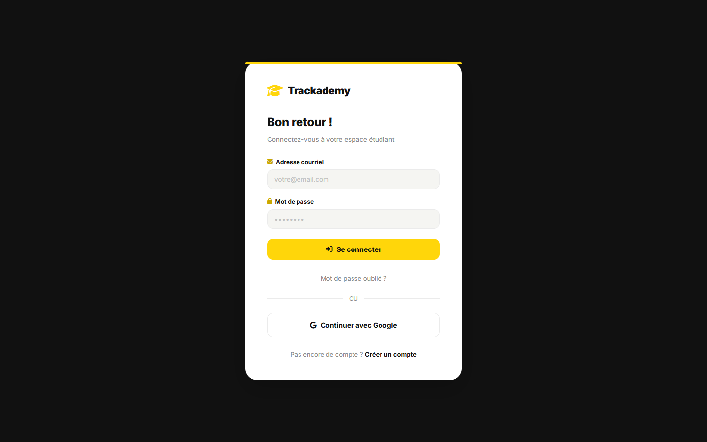
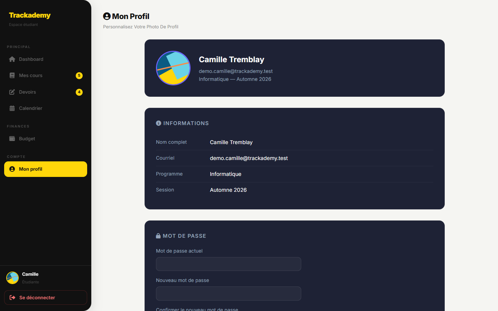

# Trackademy

Application web qui réunit la vie étudiante au même endroit : cours, devoirs, calendrier et budget, dans un tableau de bord personnel.



## Fonctionnalités

- **Tableau de bord** : prochains devoirs, nombre de cours actifs et solde du budget en un coup d'œil.
- **Cours** : nom, professeur, horaire, salle, crédits et couleur pour les repérer.
- **Devoirs** : date de remise, cours associé et statut (à faire, en cours, terminé), avec filtres par statut.
- **Calendrier** : examens, remises, cours et autres événements, par mois.
- **Budget** : revenus et dépenses par catégorie (bourse, loyer, nourriture, transport…), total entrant, total sortant et solde.
- **Comptes** : inscription et connexion par courriel et mot de passe (Spring Security, mots de passe chiffrés avec BCrypt).
- **Connexion avec Google** (OAuth2) : le compte étudiant est créé à la première connexion, puis retrouvé aux suivantes.
- **Mot de passe** : changement depuis le profil, et réinitialisation par un lien envoyé par courriel, valable 1 heure.
- **API REST** protégée par jetons JWT, à côté des pages web.
- **Données isolées par utilisateur** : chaque étudiant ne voit que ses propres cours, devoirs, événements et transactions.
- **Profil** : informations de l'étudiant et galerie d'avatars.

| Cours | Devoirs | Budget |
|---|---|---|
|  |  |  |

| Connexion | Profil |
|---|---|
|  |  |

## Stack

- **Java 21**, **Spring Boot 4**
- **Spring MVC** et **Thymeleaf** pour les pages
- **Spring Security** : formulaire de connexion, **OAuth2** (Google) et jetons **JWT** (jjwt)
- **Spring Mail** pour le courriel de réinitialisation
- **Spring Data JPA** / Hibernate avec **MySQL**
- **Docker** (build multi-étapes) et configuration **Render**

## Lancer le projet en local

Prérequis : Java 21 et un serveur MySQL (ou MariaDB).

1. Créez la base de données :

   ```sql
   CREATE DATABASE trackademydb;
   ```

2. Dans `Trackademy/src/main/resources/application.properties`, renseignez l'utilisateur et le mot de passe de votre base (`spring.datasource.username`, `spring.datasource.password`).

3. Démarrez l'application :

   ```bash
   cd Trackademy
   ./mvnw spring-boot:run
   ```

   Sous Windows : `mvnw.cmd spring-boot:run`.

4. Ouvrez http://localhost:8080 et créez un compte depuis la page d'inscription.

Les tables sont créées et mises à jour automatiquement au démarrage (`spring.jpa.hibernate.ddl-auto=update`).

> Avec MariaDB, si les tables ne sont pas créées, utilisez le dialecte MariaDB :
> `spring.jpa.database-platform=org.hibernate.dialect.MariaDBDialect`.

## Variables d'environnement

Les valeurs sensibles sont lues depuis des variables d'environnement. Toutes sont facultatives en local : sans elles, la fonctionnalité concernée est simplement désactivée ou utilise une valeur de repli.

| Variable | Utilité | Sans la variable |
|---|---|---|
| `GOOGLE_CLIENT_ID` | Identifiant du client OAuth Google | Le bouton « Continuer avec Google » ne fonctionne pas |
| `GOOGLE_CLIENT_SECRET` | Secret du client OAuth Google | Idem |
| `JWT_SECRET` | Clé de signature des jetons de l'API | Une clé par défaut est utilisée : **à définir en production** |
| `SMTP_HOST` | Serveur d'envoi des courriels | Le lien de réinitialisation est écrit dans les journaux du serveur |
| `SMTP_PORT` | Port SMTP | `587` |
| `SMTP_USERNAME` | Compte SMTP, aussi utilisé comme expéditeur | — |
| `SMTP_PASSWORD` | Mot de passe SMTP (ou mot de passe d'application) | — |
| `APP_BASE_URL` | Adresse publique de l'app, utilisée dans le lien de réinitialisation | `http://localhost:8080` |

Les jetons JWT sont valables 24 heures (`jwt.expiration-ms`).

### Configurer la connexion Google

1. Dans la [Google Cloud Console](https://console.cloud.google.com/apis/credentials), créez un **ID client OAuth** de type « Application Web ».
2. Ajoutez l'URI de redirection autorisée : `http://localhost:8080/login/oauth2/code/google` (et l'équivalent avec l'adresse de production).
3. Définissez `GOOGLE_CLIENT_ID` et `GOOGLE_CLIENT_SECRET` avant de démarrer l'application.

## API REST

L'API, sous `/api/**`, est sans session et protégée par jeton JWT. Les pages web gardent la connexion par session.

Obtenir un jeton :

```bash
curl -X POST http://localhost:8080/api/auth/login \
  -H "Content-Type: application/json" \
  -d '{"email": "etudiant@example.com", "motDePasse": "votre-mot-de-passe"}'
```

Réponse : `{"token": "eyJhbGciOi..."}`. Utiliser ensuite le jeton :

```bash
curl http://localhost:8080/api/auth/me -H "Authorization: Bearer <jeton>"
```

| Méthode | Route | Description |
|---|---|---|
| `POST` | `/api/auth/login` | Renvoie un jeton JWT ; `401` si les identifiants sont incorrects |
| `GET` | `/api/auth/me` | Renvoie le courriel de l'étudiant connecté (jeton requis) |

## Docker

```bash
cd Trackademy
docker build -t trackademy .
docker run -p 8080:8080 \
  -e SPRING_DATASOURCE_URL="jdbc:mysql://host.docker.internal:3306/trackademydb" \
  -e SPRING_DATASOURCE_USERNAME=root \
  -e SPRING_DATASOURCE_PASSWORD=motdepasse \
  -e JWT_SECRET=une-longue-cle-aleatoire \
  trackademy
```

Spring Boot lit les variables `SPRING_DATASOURCE_*`, qui remplacent les valeurs de `application.properties`. Ajoutez les autres variables (Google, SMTP) de la même façon.

## Déploiement sur Render

`Trackademy/render.yaml` décrit un service web Java et une base de données. Sur Render : **New + → Blueprint**, choisissez ce dépôt, puis indiquez `Trackademy` comme répertoire racine si Render le demande. Les identifiants de la base sont injectés par `SPRING_DATASOURCE_URL`, `SPRING_DATASOURCE_USERNAME` et `SPRING_DATASOURCE_PASSWORD`.

Ajoutez ensuite dans **Environment** au moins `JWT_SECRET` et `APP_BASE_URL` (l'adresse Render du service), plus `GOOGLE_CLIENT_ID`, `GOOGLE_CLIENT_SECRET` et les variables `SMTP_*` pour activer la connexion Google et l'envoi des courriels.

## Structure

```
Trackademy/
  src/main/java/com/elpzang/trackademy/
    config/        sécurité : chaîne API (JWT, sans session) et chaîne pages (session, formulaire, Google)
    controller/    pages et API : tableau de bord, cours, devoirs, calendrier, budget, profil, connexion, /api/auth
    entite/        Etudiant, Cours, Devoir, Evenement, Transaction
    repository/    accès aux données (Spring Data JPA)
    security/      JwtService, JwtAuthFilter, utilisateur OAuth2
    service/       logique métier, courriel, utilisateurs Google
  src/main/resources/templates/   vues Thymeleaf
  Dockerfile
  render.yaml
```

## En cours de développement

- Interface en plusieurs langues (français, anglais…)

## Auteur

Erwin Lashwana Prammo Zang — [GitHub](https://github.com/lashwanap)
